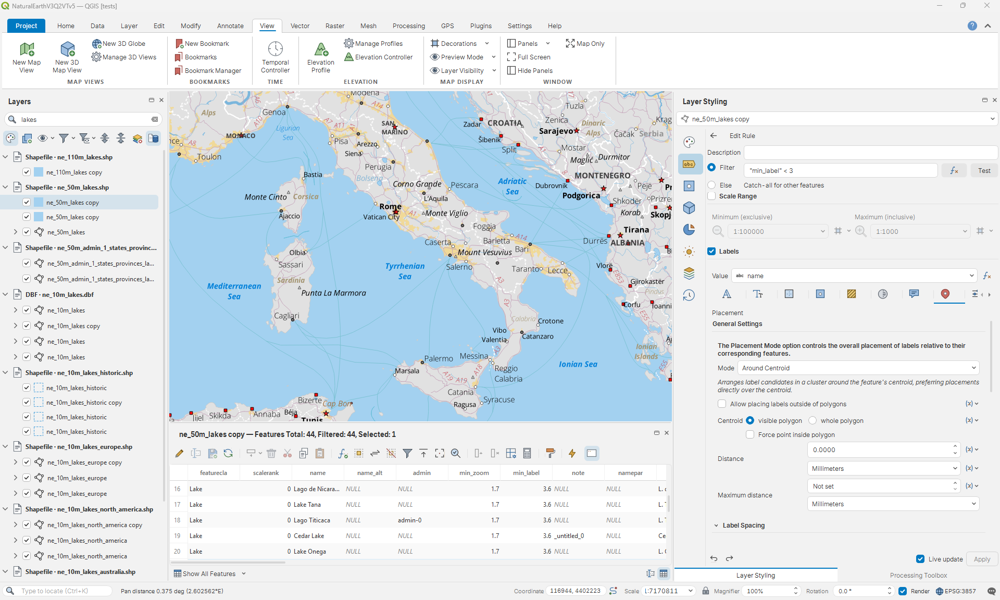
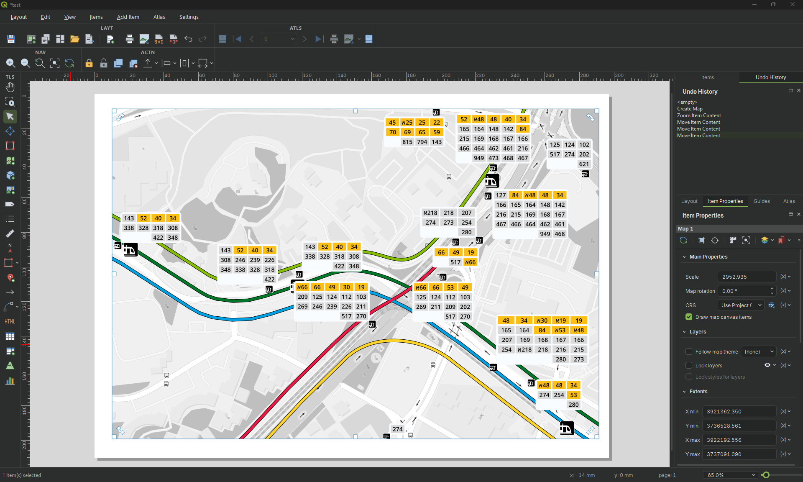
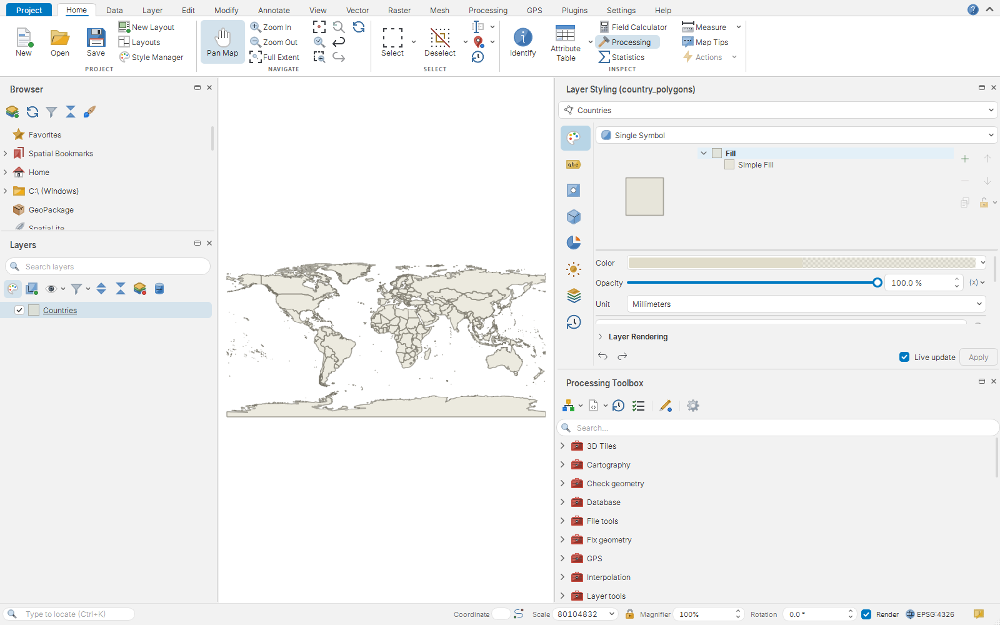
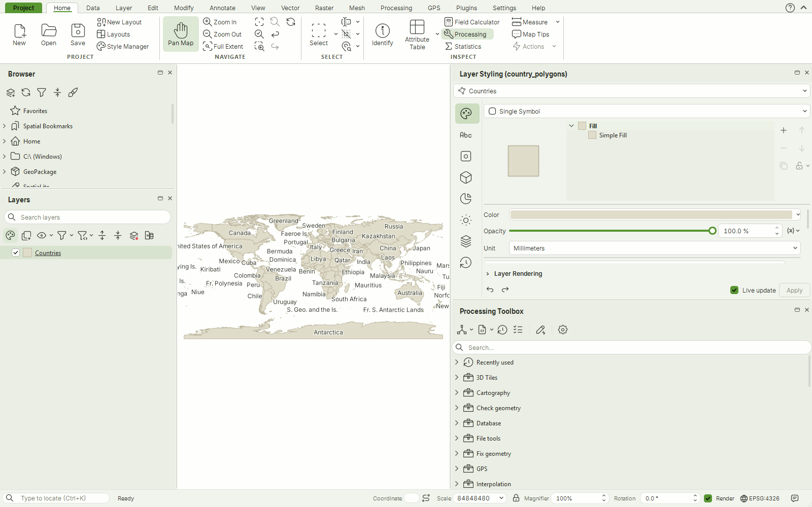
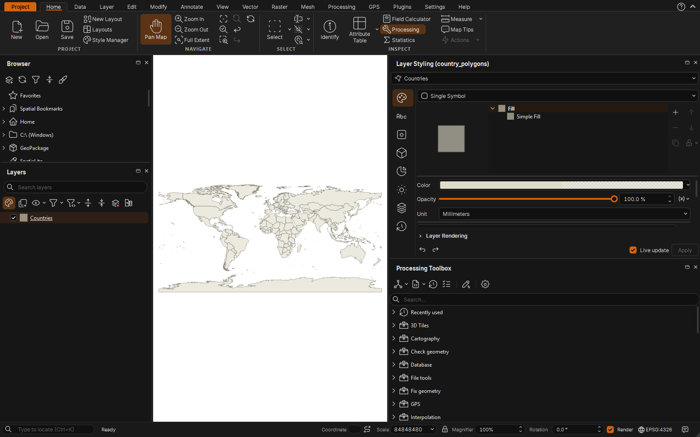
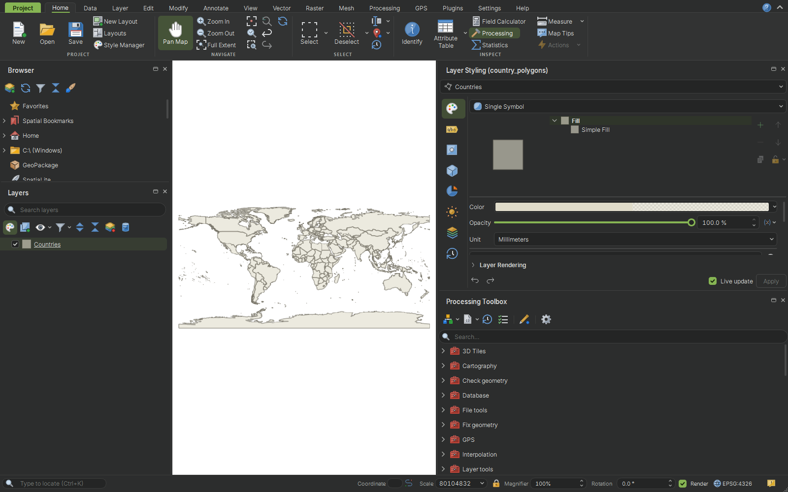
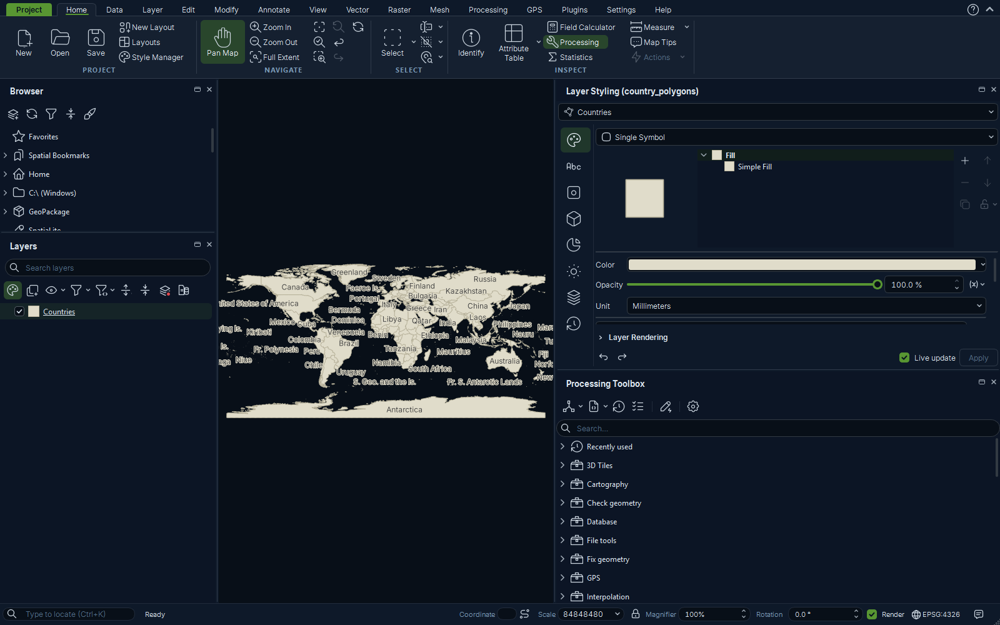
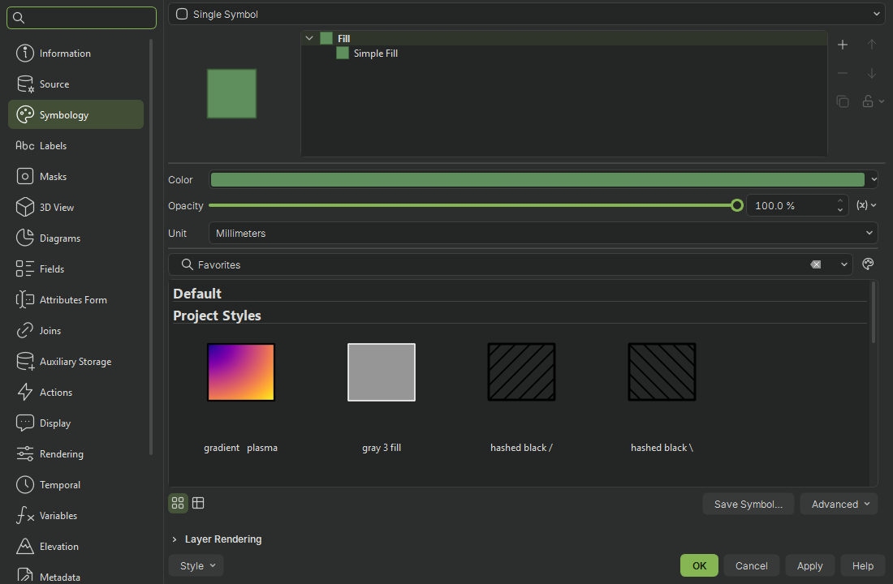
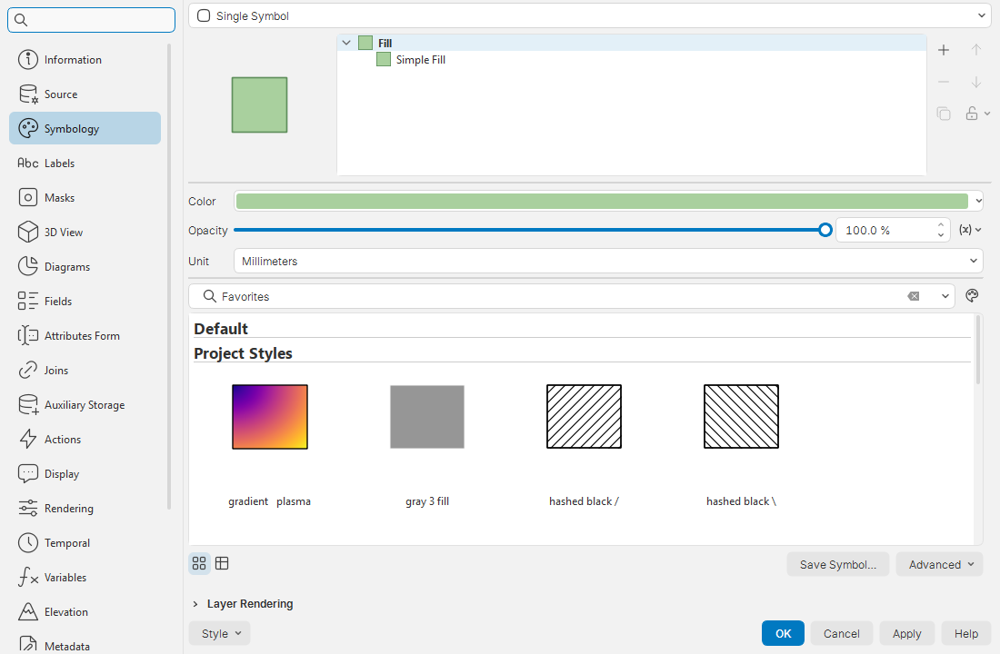
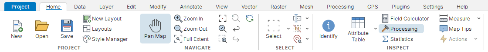

# QGIS Studio Themes

Six modern UI themes for QGIS 4: a clean stylesheet, a complete icon set,
the Inter typeface and an optional ribbon.

<kbd></kbd>

<table>
<tr>
<td width="50%" align="center"><kbd></kbd></td>
<td width="50%" align="center"><kbd></kbd></td>
</tr>
</table>

## Install

1. **Plugins → Manage and Install Plugins** → install **QGIS Studio Themes**
   (or download it from the [plugin repository](https://plugins.qgis.org/plugins/qgis_studio_themes/)).
2. **Settings → Options → General → UI Theme** → pick a Studio theme.
3. Restart QGIS.

Requires QGIS 4.0 or later.

## Themes

<table>
<tr>
<td width="50%" valign="top">
<b>Studio Pro Light</b> Light grey, blue accents  
<kbd></kbd>
</td>
<td width="50%" valign="top">
<b>Studio QGIS Light</b> Light paper, <a href="https://qgis.org/styleguide/">QGIS brand</a> colours  
<kbd></kbd>
</td>
</tr>
<tr>
<td width="50%" valign="top">
<b>Studio Orange Light</b> Warm paper, <a href="https://kartoza.com">Kartoza</a> colours  
<kbd></kbd>
</td>
<td width="50%" valign="top">
<b>Studio Orange Dark</b> Near-black, orange accents  
<kbd></kbd>
</td>
</tr>
<tr>
<td width="50%" valign="top">
<b>Studio Premium Dark</b> Neutral grey, QGIS green accents  
<kbd></kbd>
</td>
<td width="50%" valign="top">
<b>Studio Web Dark</b> Navy, like qgis.org  
<kbd></kbd>
</td>
</tr>
<tr>
<td width="50%" valign="top">
<b>Layer Properties</b> Premium Dark  
<kbd></kbd>
</td>
<td width="50%" valign="top">
<b>Layer Properties</b> Pro Light  
<kbd></kbd>
</td>
</tr>
</table>

## Icons

Three styles, switched instantly in **Plugins → QGIS Studio Themes → Settings → Icons**:

- **Monochrome** (default): clean line icons in the theme's colour.
- **Colourful**: solid, flat colour icons in the style of professional GIS
  and Office icon sets.
- **QGIS classic**: QGIS's own icons.

Monochrome and Colourful replace icons across the whole interface and are
pixel-sharp at every screen scaling.

<table>
<tr>
<td width="33%" align="center"><b>Monochrome</b>  <kbd></kbd></td>
<td width="33%" align="center"><b>Colourful</b>  <kbd></kbd></td>
<td width="33%" align="center"><b>QGIS classic</b>  <kbd></kbd></td>
</tr>
</table>

## Features

- **Ribbon** (optional, **Settings → Interface**): every toolbar and menu
  command in tabs of large and small buttons, plugins included. Inspired by
  the [Ribbon Toolbar](https://github.com/eithanwes/ribbon_toolbar) plugin
  by Eithan Wes and Anita Graser. Compact by default; its size (small, medium,
  large or QGIS's icon size) and density (compact or standard) are settings, and its group
  names can go above, below or left of the buttons, or be turned off.
- **Toolbar names** next to each toolbar's buttons, with configurable
  position, length, size and weight.
- **Layers panel**: a search field and a *List by Data Source* view.
- **Clean layout**: flat buttons and tabs, roomy panel rows, slim
  scrollbars and the bundled Inter typeface.
- **Follows QGIS's icon size** in the ribbon, panels and dialogs.
- **Fast**: icons are drawn once and shared by every theme.

## Contributing

Pull requests are welcome; for larger changes, open an
[issue](https://github.com/GallPeters/qgis-studio-themes/issues) first.

## License

[GNU GPL v2](LICENSE). Bundled: [Tabler Icons](https://github.com/tabler/tabler-icons)
(MIT, `icons/tabler/LICENSE`) and [Inter](https://rsms.me/inter/) (OFL 1.1, `fonts/OFL.txt`).
