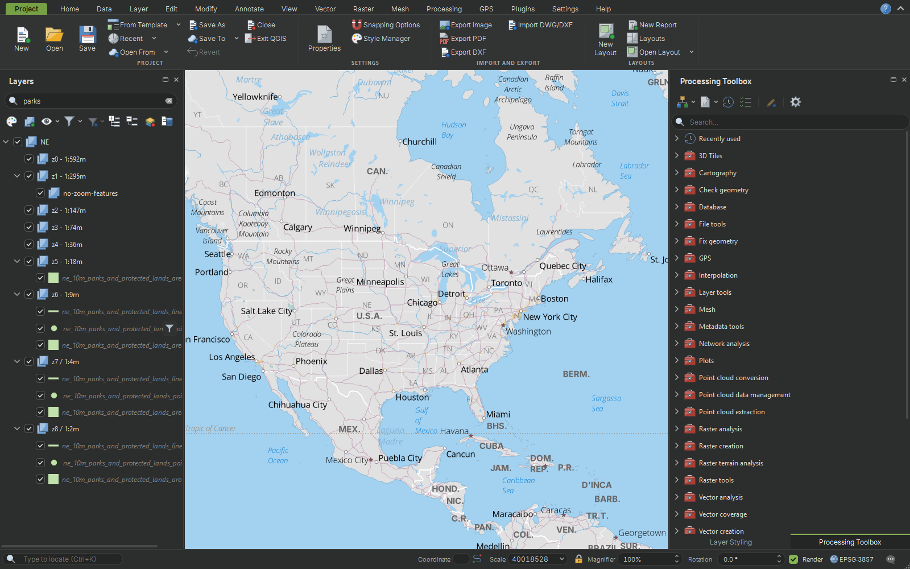
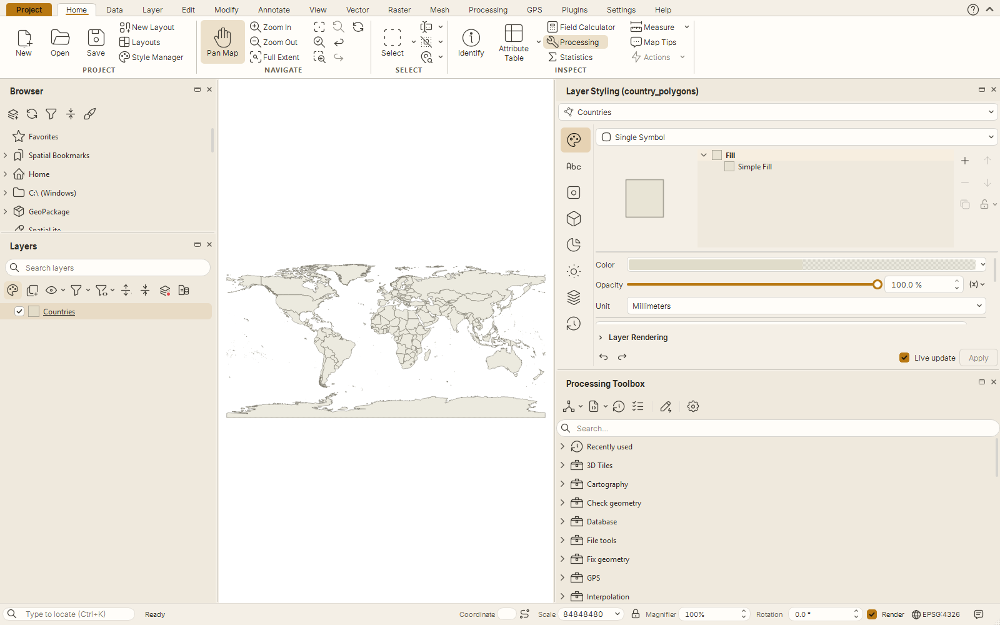
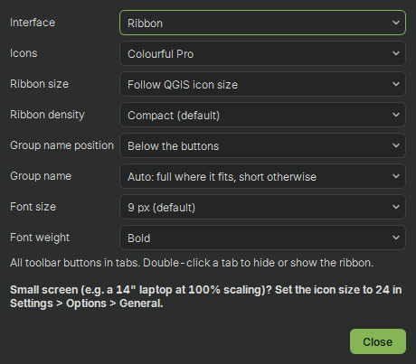
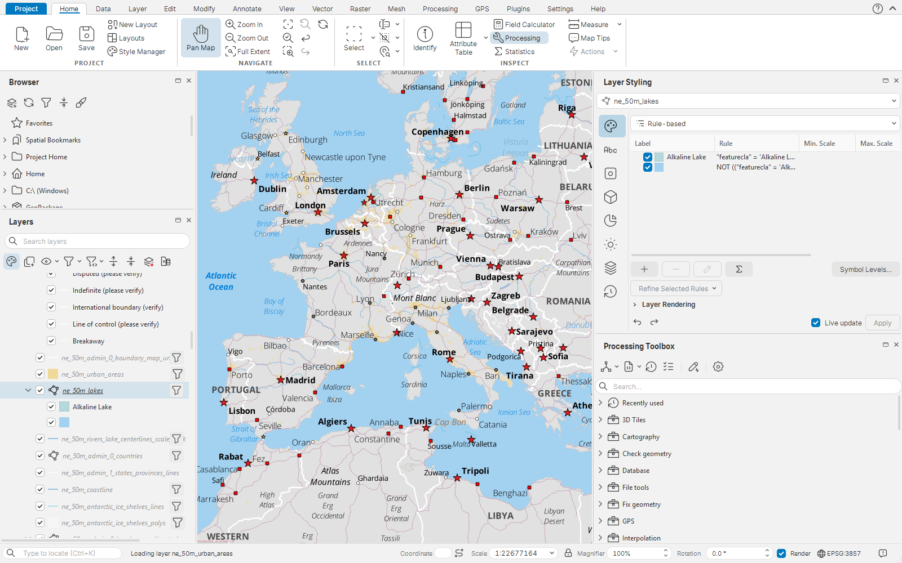
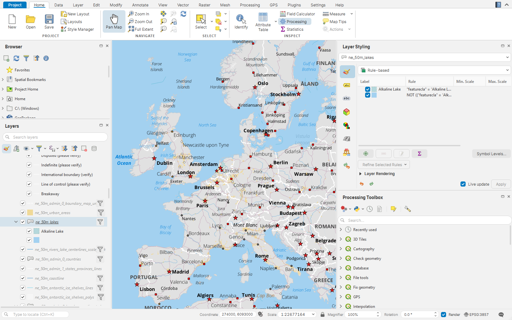

# QGIS Studio Themes

Six modern UI themes for QGIS 4: a clean stylesheet, a complete icon set,
the Inter typeface and an optional ribbon.

<kbd></kbd>

## Install

1. **Plugins → Manage and Install Plugins**: install QGIS Studio Themes, or download it
   from the [plugin repository](https://plugins.qgis.org/plugins/qgis_studio_themes/).
2. **Settings → Options → General → UI Theme**: pick a Studio theme.
3. Restart QGIS.

Requires QGIS 4.0 or later.

## Themes

<table>
<tr>
<td width="50%" valign="top">
<b>Studio Pro Light</b> Light grey, blue accents  
<kbd></kbd>
</td>
<td width="50%" valign="top">
<b>Studio Premium Dark</b> Neutral grey, QGIS green accents  
<kbd></kbd>
</td>
</tr>
<tr>
<td width="50%" valign="top">
<b>Studio Web Dark</b> Navy, like qgis.org  
<kbd></kbd>
</td>
<td width="50%" valign="top">
<b>Studio Orange Dark</b> Near-black, orange accents  
<kbd></kbd>
</td>
</tr>
<tr>
<td width="50%" valign="top">
<b>Studio Orange Light</b> Warm paper, <a href="https://kartoza.com">Kartoza</a> colours  
<kbd></kbd>
</td>
<td width="50%" valign="top">
<b>Studio QGIS Light</b> Light paper, <a href="https://qgis.org/styleguide/">QGIS brand</a> colours  
<kbd></kbd>
</td>
</tr>
</table>

## Settings

Open them in Plugins → QGIS Studio Themes → Settings. Every change shows at once.

<kbd></kbd>

- **Interface**: toolbars or a ribbon.
- **Icons**: monochrome, colourful or QGIS classic.
- **Ribbon size**: small, medium, large, or follow QGIS's icon size.
- **Ribbon density**: compact saves height, standard gives the icons more room.
- **Group name position**: above, below or left of the buttons, or off.
- **Group name**: full, short, or auto, which shortens names that don't fit.
- **Font size**: the size of the group names.
- **Font weight**: bold, regular or light group names.

With toolbars, the group name settings apply to the toolbar names.

## Icons

- **Monochrome**: clean line icons in the theme's colour. The default.
- **Colourful**: solid, flat colour icons, like professional GIS and Office icon sets.
- **QGIS classic**: QGIS's own icons.

Monochrome and Colourful replace icons across the whole interface and stay
pixel-sharp at every screen scaling.

<b>Monochrome</b> 
<kbd></kbd>  

<b>Colourful</b> 
<kbd></kbd>  

<b>QGIS classic</b> 
<kbd></kbd>

## Features

- **Ribbon**: every toolbar and menu command in tabs of large and small buttons,
  plugins included. Inspired by the [Ribbon Toolbar](https://github.com/eithanwes/ribbon_toolbar)
  plugin by Eithan Wes and Anita Graser.
- **Toolbar names**: a name next to each toolbar's buttons.
- **Layers panel**: a search field and a List by Data Source view.
- **Clean layout**: flat buttons and tabs, roomy panel rows, slim scrollbars
  and the bundled Inter typeface.
- **QGIS icon size**: the ribbon, panels and dialogs follow it.
- **Fast**: icons are drawn once and shared by every theme.

## Contributing

Pull requests are welcome; for larger changes, open an
[issue](https://github.com/GallPeters/qgis-studio-themes/issues) first.

## License

[GNU GPL v2](LICENSE). Bundled: [Tabler Icons](https://github.com/tabler/tabler-icons)
(MIT, `icons/tabler/LICENSE`) and [Inter](https://rsms.me/inter/) (OFL 1.1, `fonts/OFL.txt`).
