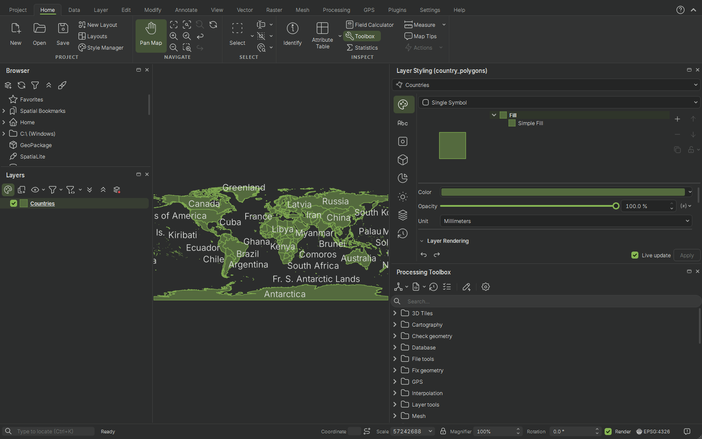
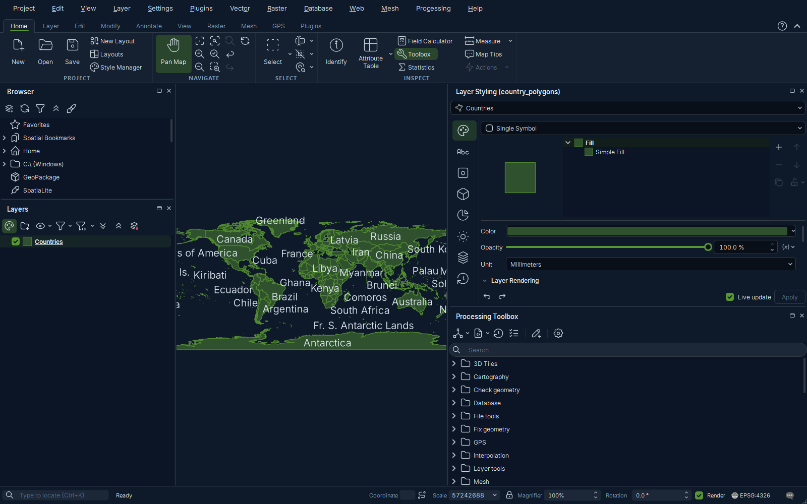
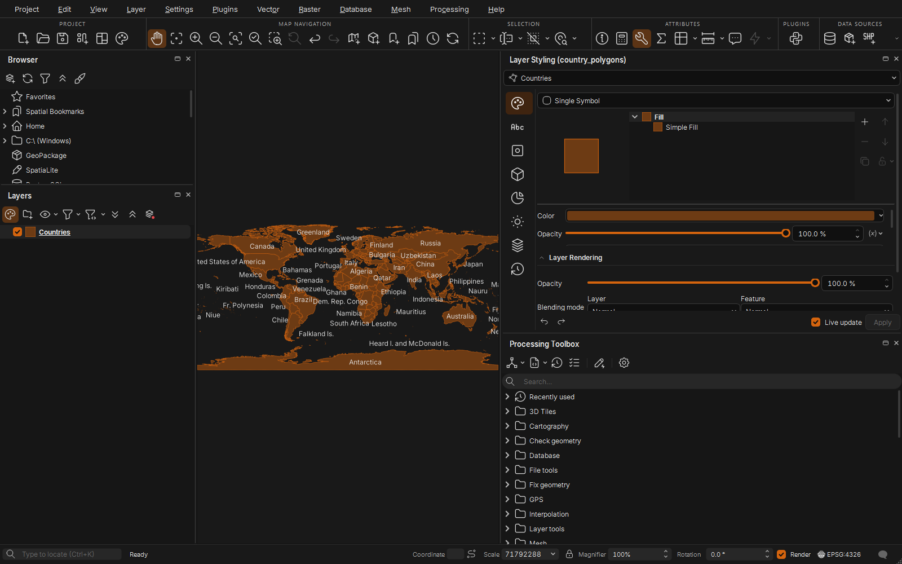
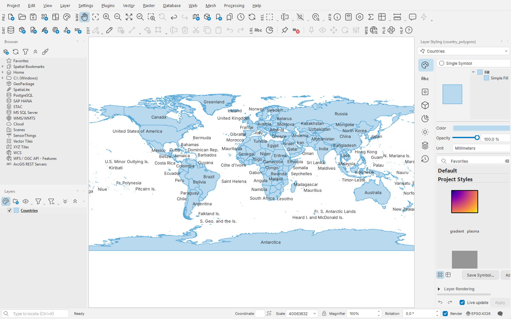
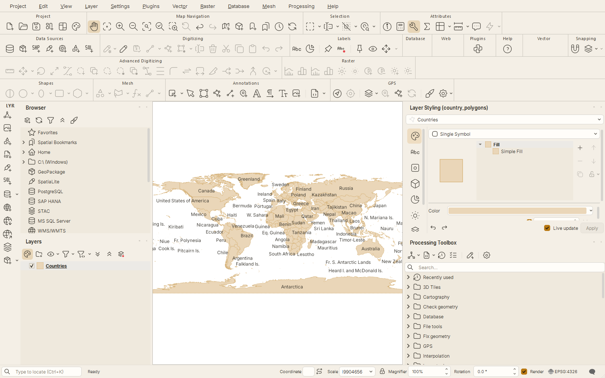
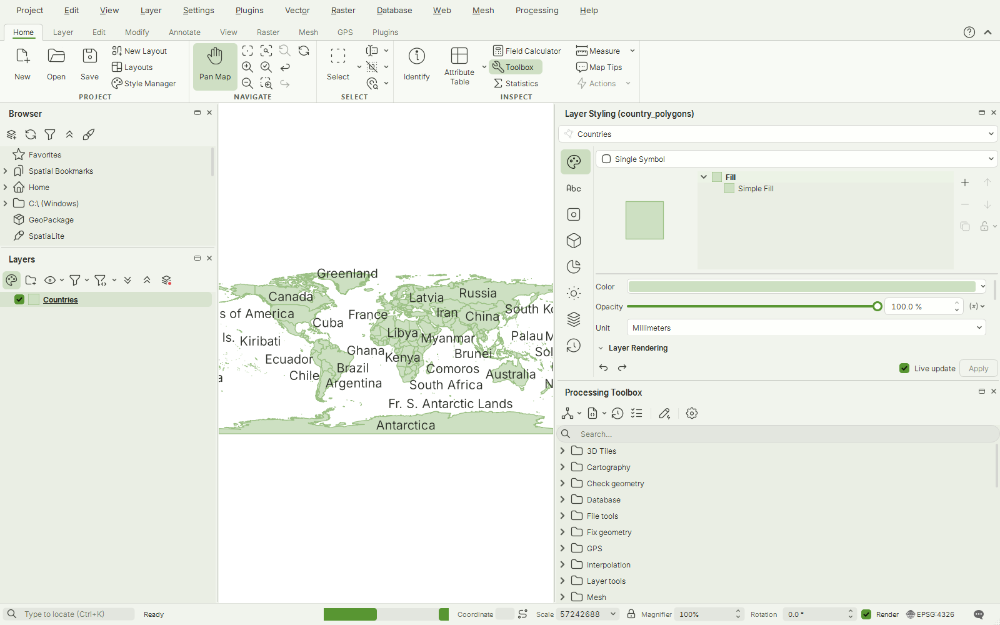
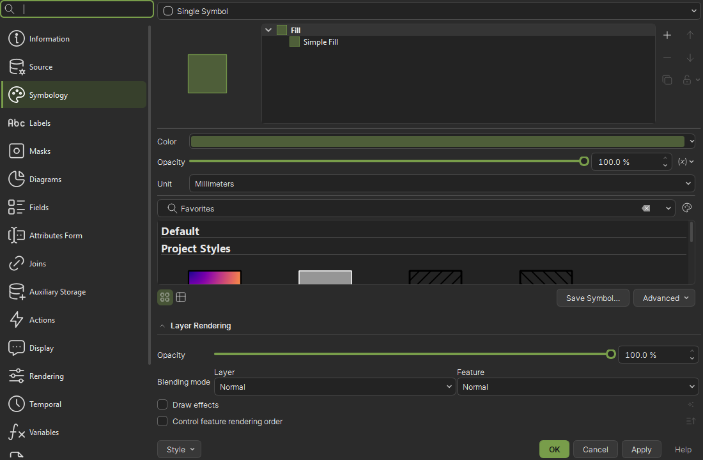
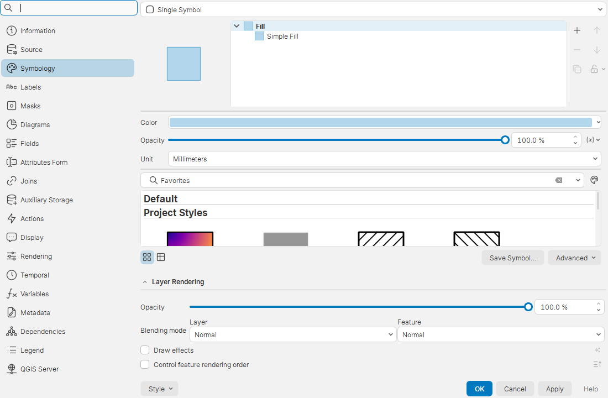

# QGIS Studio Themes

A QGIS plugin that adds six UI themes with a consistent, modern design:
a redesigned stylesheet, a unified line-icon set and the Inter typeface.

## Requirements

QGIS 4.0 or later.

## Installation

1. Install **QGIS Studio Themes** from **Plugins → Manage and Install Plugins**,
   or download it from the [QGIS plugin repository](https://plugins.qgis.org/plugins/qgis_studio_themes/).
2. Open **Settings → Options → General**.
3. Select a Studio theme under **UI Theme**.
4. Restart QGIS.

## Themes

| Theme | Mode | Palette |
|---|---|---|
| Studio Premium Dark | Dark | Neutral grey with QGIS green accents |
| Studio Web Dark | Dark | Navy, based on the qgis.org website |
| Studio Orange Dark | Dark | Near-black with orange accents |
| Studio Pro Light | Light | Light grey with blue accents |
| Studio Orange Light | Light | Warm paper with [Kartoza](https://kartoza.com) brand colours |
| Studio QGIS Light | Light | Light paper with the [QGIS brand](https://qgis.org/styleguide/) colours |

Each theme sets the Qt colour scheme to match its mode, so native widgets
stay consistent with the stylesheet regardless of the desktop's light or
dark setting. The two light themes were checked against WCAG 2.2 AA
contrast requirements.

## Screenshots

| Studio Premium Dark | Studio Web Dark |
|---|---|
|  |  |
| **Studio Orange Dark** | **Studio Pro Light** |
|  |  |
| **Studio Orange Light** | **Studio QGIS Light** |
|  |  |

Layer properties dialog in Studio Premium Dark and Studio Pro Light:

| | |
|---|---|
|  |  |

## Features

- **Icons** – over 600 QGIS toolbar, menu, panel and dialog icons are
  replaced with a consistent line-icon set based on
  [Tabler Icons](https://tabler.io/icons), coloured for each theme.
- **Sharp on every screen** – icons are pre-rendered for the exact pixel
  size each screen draws them at (100%, 125%, 150%... scaling), with their
  lines snapped to the pixel grid, so they stay crisp instead of blurring
  on large monitors. Arrows, check marks and other widget glyphs are drawn
  at their exact size.
- **Toolbar titles** – each toolbar's name sits centred above its buttons,
  between two hairlines (vertical toolbars show a short name on their
  handle). Turn them off with **View → Studio Toolbar Labels**.
- **Typography** – the bundled Inter typeface is used unless a custom font
  is set in QGIS options. The configured font size is always kept.
- **Sizes for every screen** – on large, low-density desktop monitors the
  plugin picks compact sizes (smaller menu and panel icons, toolbar icons
  the size of QGIS's own), while laptops keep the roomier look. Override it with
  **View → Studio Compact Sizes** (applies after a restart).
- **Layout** – thin dividers, rounded controls, underlined tabs, slim
  scrollbars, accent-coloured selection and a message bar that follows
  the theme.
- **Performance** – base colours are set through the Qt palette rather than
  broad stylesheet rules, which keeps dialog opening and repainting faster
  than in previous versions.

## Contributing

Pull requests are welcome. For larger changes, please open an issue first.
Bug reports can be filed on the [issue tracker](https://github.com/GallPeters/qgis-studio-themes/issues).

## License

[GNU GPL v2](LICENSE)

Bundled third-party assets:

- [Tabler Icons](https://github.com/tabler/tabler-icons) – MIT License, see `icons/tabler/LICENSE`
- [Inter](https://rsms.me/inter/) – SIL Open Font License 1.1, see `fonts/OFL.txt`
