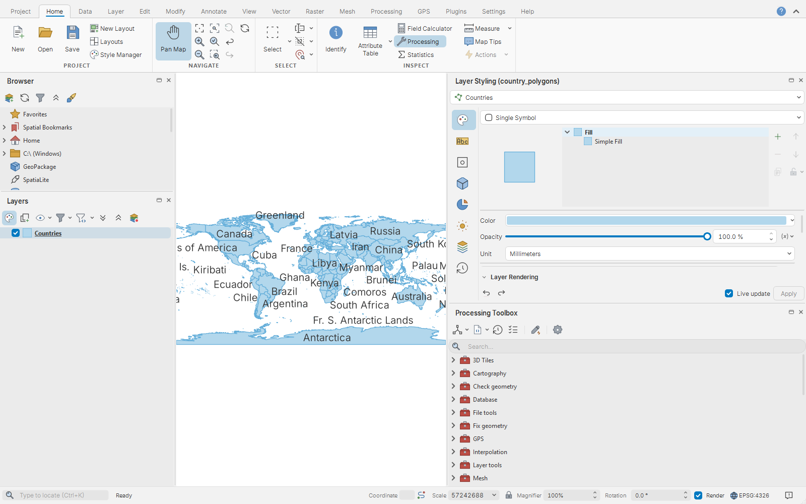
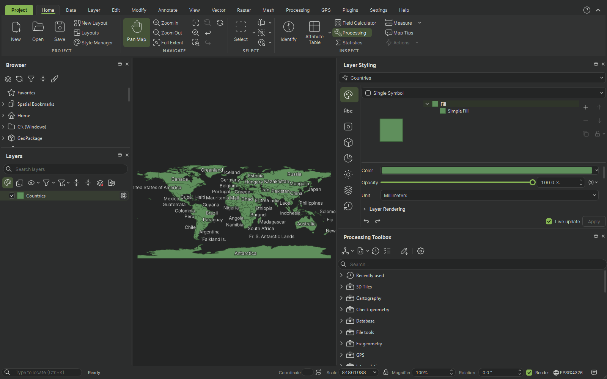
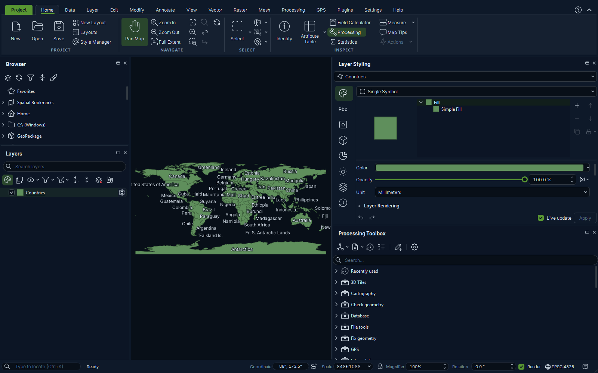
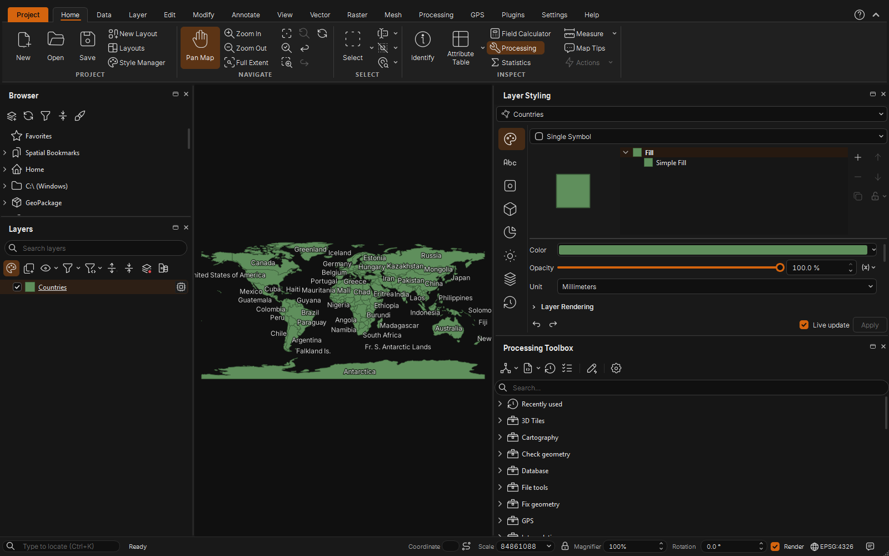
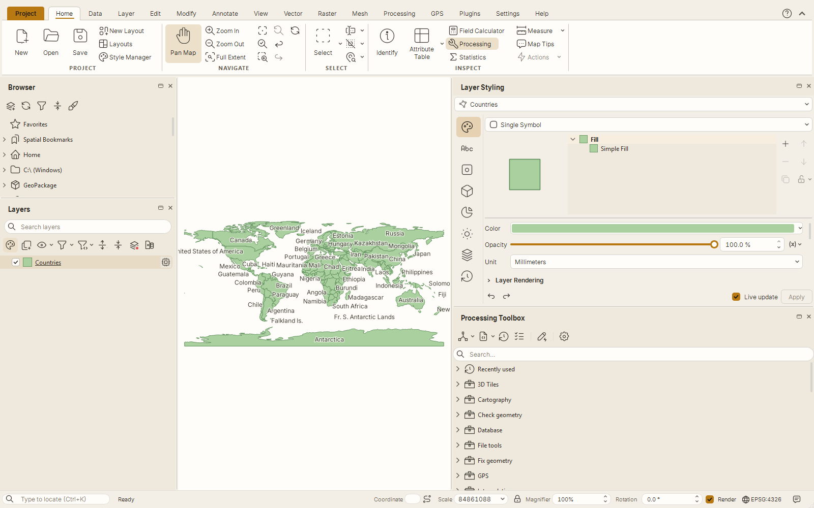
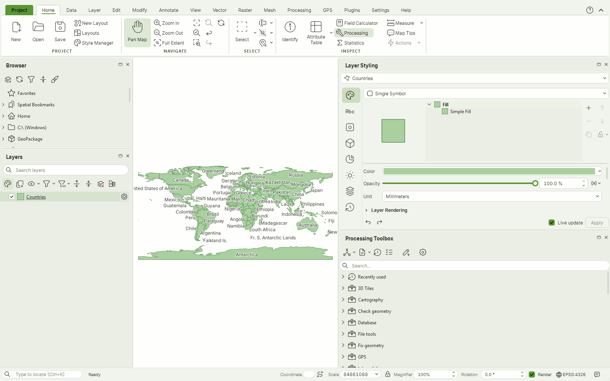
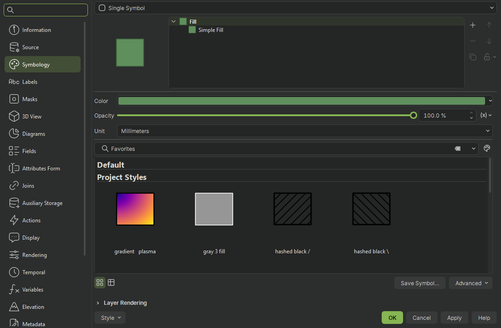
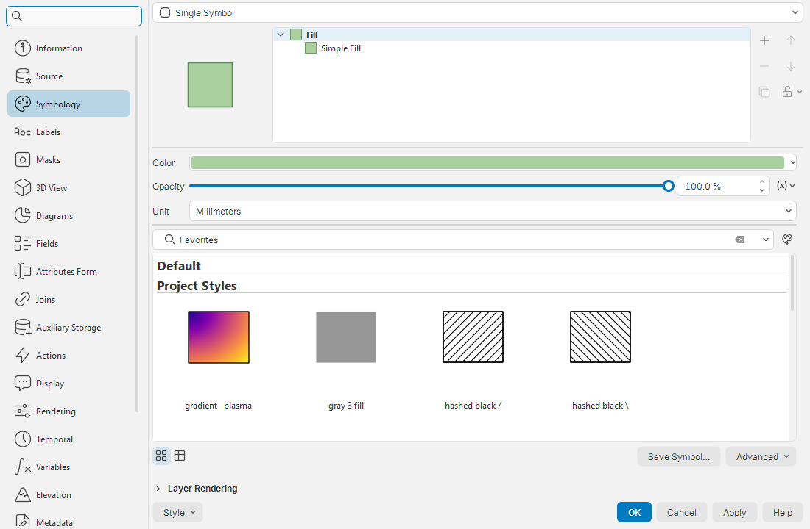
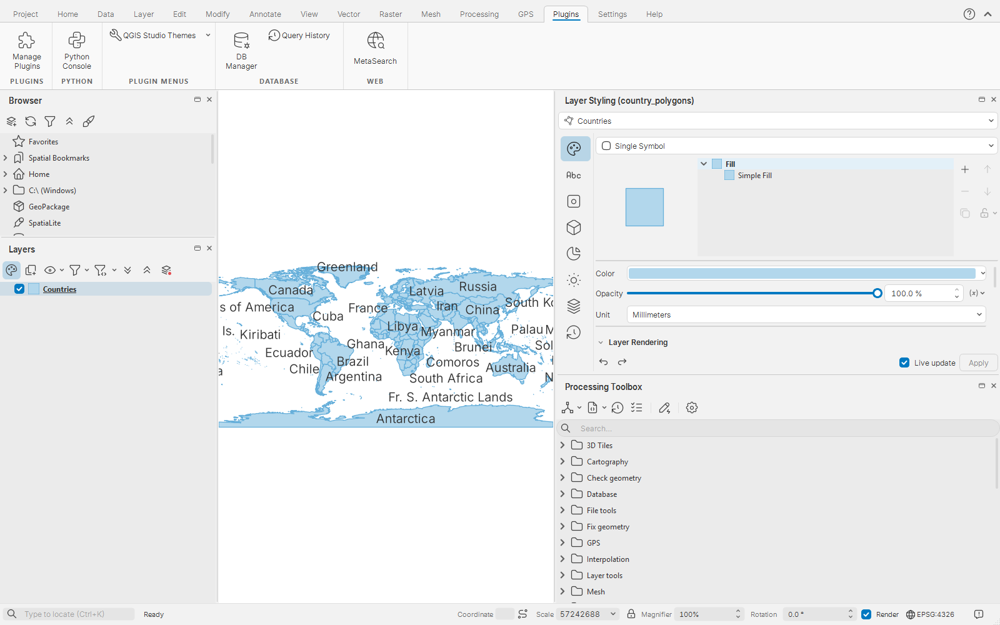
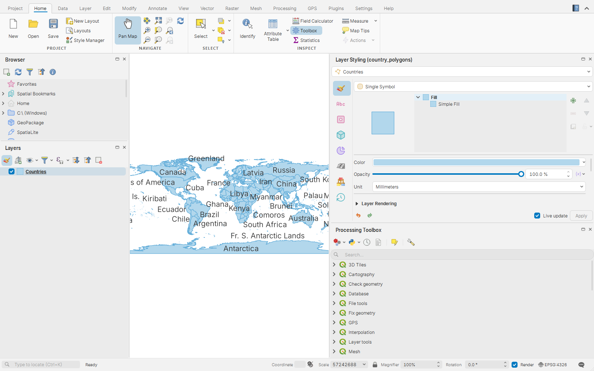

# QGIS Studio Themes

Six modern UI themes for QGIS 4: a clean stylesheet, a complete icon set,
the Inter typeface and an optional ribbon.

## Install

1. **Plugins → Manage and Install Plugins** → install **QGIS Studio Themes**
   (or download it from the [plugin repository](https://plugins.qgis.org/plugins/qgis_studio_themes/)).
2. **Settings → Options → General → UI Theme** → pick a Studio theme.
3. Restart QGIS.

Requires QGIS 4.0 or later.

## Themes

| Theme | Look |
|---|---|
| Studio Pro Light | Light grey, blue accents |
| Studio Orange Light | Warm paper, [Kartoza](https://kartoza.com) colours |
| Studio QGIS Light | Light paper, [QGIS brand](https://qgis.org/styleguide/) colours |
| Studio Premium Dark | Neutral grey, QGIS green accents |
| Studio Web Dark | Navy, like qgis.org |
| Studio Orange Dark | Near-black, orange accents |

| Studio Premium Dark | Studio Web Dark |
|---|---|
|  |  |
| **Studio Orange Dark** | **Studio Orange Light** |
|  |  |
| **Studio QGIS Light** | **Layer Properties (Premium Dark / Pro Light)** |
|  |   |

## Icons

Three styles, switched instantly in **Plugins → QGIS Studio Themes → Settings → Icons**:

- **Monochrome** (default): clean line icons in the theme's colour.
- **Colourful**: solid, flat colour icons in the style of professional GIS
  and Office icon sets.
- **QGIS classic**: QGIS's own icons.

Monochrome and Colourful replace icons across the whole interface and are
pixel-sharp at every screen scaling.

| Monochrome | Colourful | QGIS classic |
|---|---|---|
|  |  |  |

## Features

- **Ribbon** (optional, **Settings → Interface**): every toolbar and menu
  command in tabs of large and small buttons, plugins included. Inspired by
  the [Ribbon Toolbar](https://github.com/eithanwes/ribbon_toolbar) plugin
  by Eithan Wes and Anita Graser.
- **Toolbar names** next to each toolbar's buttons, with configurable
  position, length, size and weight.
- **Layers panel**: a search field and a *List by Data Source* view.
- **Clean layout**: flat buttons and tabs, roomy panel rows, slim
  scrollbars and the bundled Inter typeface.
- **Follows QGIS's icon size** in the ribbon, panels and dialogs.
- **Fast**: icons are drawn once and shared by every theme.

## Contributing

Pull requests are welcome; for larger changes, open an
[issue](https://github.com/GallPeters/qgis-studio-themes/issues) first.

## License

[GNU GPL v2](LICENSE). Bundled: [Tabler Icons](https://github.com/tabler/tabler-icons)
(MIT, `icons/tabler/LICENSE`) and [Inter](https://rsms.me/inter/) (OFL 1.1, `fonts/OFL.txt`).
